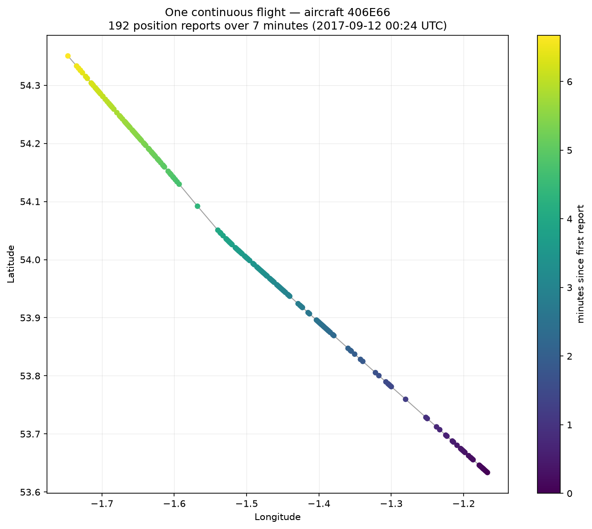

# LU ZIYI — Data Science Portfolio

## About me

I am a Master's student at the **University of Macau**, studying data science and
data visualization (CISC7204). I work mainly in **Python**, taking a question from
raw, messy data through cleaning, exploration and modelling to a visualization
that a reader can actually act on.

I care most about the step between a table and an insight: choosing an encoding
that makes the answer obvious, and being honest about what the data does *not*
support. I am currently building out this portfolio with the projects I complete
during my coursework.

## Technical skills

| Area | Tools |
|---|---|
| Languages | Python 3, SQL (basic), HTML/Markdown |
| Data handling | pandas, NumPy, SciPy |
| Visualization | matplotlib, seaborn, Plotly, Dash, Bokeh |
| Machine learning | scikit-learn (regression, clustering, model evaluation) |
| Environment | Jupyter Notebook / JupyterLab, Anaconda, Git, GitHub |

## Project showcase

### Flight Movement Analysis — Aircraft Tracks Around Leeds

**Research question.** How does aircraft traffic behave over time in the airspace
around Leeds, and can the raw ADS-B position reports be reduced to a small number
of interpretable descriptors of that traffic?

**Dataset.** 33,766 ADS-B position reports covering 2017/09/11–2017/09/16 from
805 distinct aircraft, distributed as course material for CISC7204.

**Visualization.**

**What the visualization shows.** Panel (a) plots all 33,766 position reports as
raw points: they form a dense blob with no visible structure. Panel (b) draws the
same points as polylines — one per aircraft, joined in time order — using the
timestamp reconstructed from the separate `date` and `time` columns. The scatter
turns into visible flight corridors, which is the evidence that ordering by the
reconstructed timestamp recovers real paths rather than producing noise.

The second figure isolates a single continuous flight (192 reports over seven
minutes). Reports from the same aircraft on different days are split into
separate segments whenever the gap between them exceeds five minutes, so no line
is ever drawn across a jump in time that was not actually flown.

**Main finding.** The airspace is dominated by **high-altitude transit**: 72.8 %
of all reports sit above 20,000 ft, while only a small secondary cluster
(1,000–5,000 ft) looks like terminal traffic, and each aircraft contributes a
median of just **18** reports. The data therefore describes *many brief
overflights* rather than a few flights tracked end to end.

**Supporting findings.**

- The airspace carries **805 distinct aircraft**, but observations are heavily
  skewed: median **18** reports per aircraft against a maximum of **564**.
- **72.8 %** of all reports are above 20,000 ft, with a secondary cluster at
  1,000–5,000 ft — a clear separation between overflights/cruise and terminal
  traffic.
- Some sampled windows contain no reports at all, so coverage is intermittent
  rather than continuous.

**One limitation.** ADS-B reception depends on ground-station coverage and line of
sight, so the file records what was *received*, not every aircraft that was
flying. Every count above is therefore a lower bound, and no conclusion about
total traffic volume should be drawn from it.

**Project repository.** [data-science-project](https://github.com/ZIY428/data-science-project)

**Project status.** ✅ **Completed**

---

## How to read this portfolio

Each project entry states the question, the data, the method, what the
visualization shows, the honest limits of the result, and a link to the full
code. If you want to reproduce anything here, every repository includes a
`README.md` with exact versions and run instructions.

*Last updated: October 2026*
