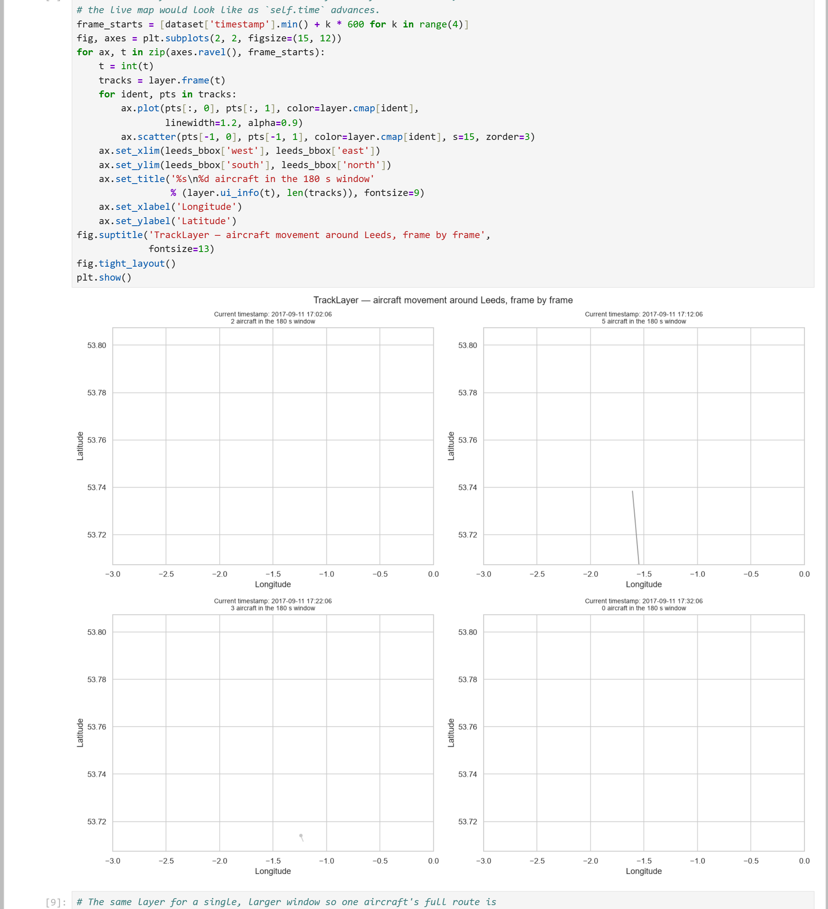

# LU ZIYI — Data Science Portfolio

## About me

I am a Master's student at the **University of Macau**, studying data science and
data visualization (CISC7204). I work mainly in **Python**, taking a question from
raw, messy data through cleaning, exploration and modelling to a visualization
that a reader can actually act on.

I care most about the step between a table and an insight: choosing an encoding
that makes the answer obvious, and being honest about what the data does *not*
support. I am currently building out this portfolio with the projects I complete
during my coursework.

## Technical skills

| Area | Tools |
|---|---|
| Languages | Python 3, SQL (basic), HTML/Markdown |
| Data handling | pandas, NumPy, SciPy |
| Visualization | matplotlib, seaborn, Plotly, Dash, Bokeh |
| Machine learning | scikit-learn (regression, clustering, model evaluation) |
| Environment | Jupyter Notebook / JupyterLab, Anaconda, Git, GitHub |

## Project showcase

### Flight Movement Analysis — Aircraft Tracks Around Leeds

**Research question.** How does aircraft traffic behave over time in the airspace
around Leeds, and can the raw ADS-B position reports be reduced to a small number
of interpretable descriptors of that traffic?

**Dataset.** 33,766 ADS-B position reports covering 2017/09/11–2017/09/16 from
805 distinct aircraft, distributed as course material for CISC7204.

**Visualization.**

**What the visualization shows.** Each polyline is one aircraft, drawn from its
position reports joined in time order; the panel shows the traffic visible inside
a rolling 180-second window. Joining the reports this way converts 33,766
scattered points into clean, readable tracks — proof that ordering by the
reconstructed timestamp recovers real flight paths rather than producing noise.

**Key findings.**

- The airspace carries **805 distinct aircraft**, but observations are heavily
  skewed: median **18** reports per aircraft against a maximum of **564**.
- **72.8 %** of all reports are above 20,000 ft, with a secondary cluster at
  1,000–5,000 ft — a clear separation between overflights/cruise and terminal
  traffic.
- Some sampled windows contain no reports at all, so coverage is intermittent
  rather than continuous.

**One limitation.** ADS-B reception depends on ground-station coverage and line of
sight, so the file records what was *received*, not every aircraft that was
flying. Every count above is therefore a lower bound, and no conclusion about
total traffic volume should be drawn from it.

**Project repository.** [data-science-project](https://github.com/ZIY428/data-science-project)

**Project status.** ✅ **Completed**

---

## How to read this portfolio

Each project entry states the question, the data, the method, what the
visualization shows, the honest limits of the result, and a link to the full
code. If you want to reproduce anything here, every repository includes a
`README.md` with exact versions and run instructions.

*Last updated: October 2026*
